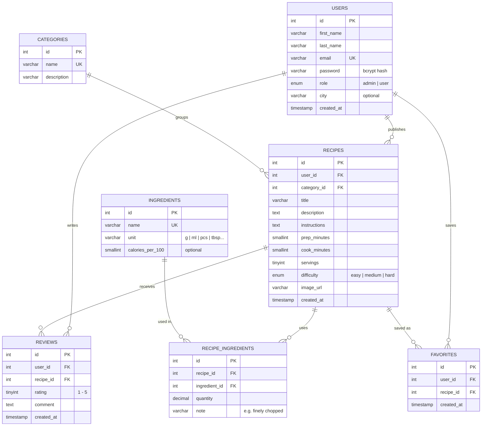

# Sofra - Entity Relationship Diagram (draft)

Sofra is a recipe-sharing app focused on Bosnian cuisine. Users publish recipes, list their
ingredients, review and save other people's recipes. Admins manage categories, ingredients,
users and moderate content.

## Relationships

| Relationship                 | Type | Rule                                                              |
|------------------------------|------|-------------------------------------------------------------------|
| User → Recipes               | 1:N  | A user publishes many recipes; a recipe has one author.           |
| Category → Recipes           | 1:N  | A category groups many recipes; a recipe belongs to one category. |
| Recipe ↔ Ingredients         | M:N  | Resolved by `recipe_ingredients` (quantity per recipe).           |
| User → Reviews / Recipe → Reviews | 1:N | One review per user per recipe (unique `user_id, recipe_id`). |
| User → Favorites / Recipe → Favorites | 1:N | A user saves a recipe at most once (unique `user_id, recipe_id`). |

`reviews` and `favorites` are two many-to-many relationships between users and recipes.

## External API
[TheMealDB](https://www.themealdb.com/api.php) - "World kitchen" page: search international recipes
by name or category; the result is shown as recipe cards and can be used as inspiration
for a new Sofra recipe. Not stored in the database.
